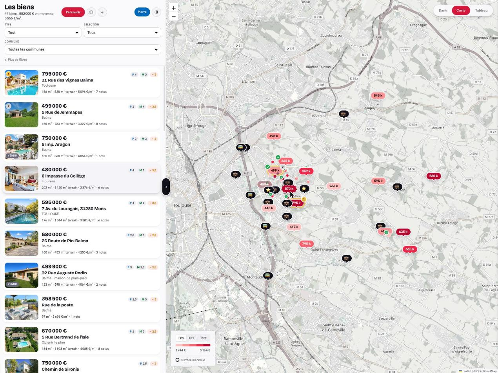
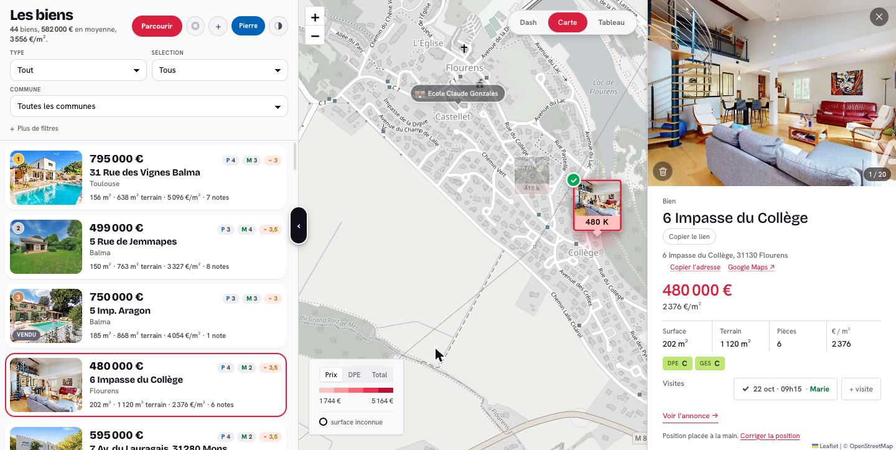
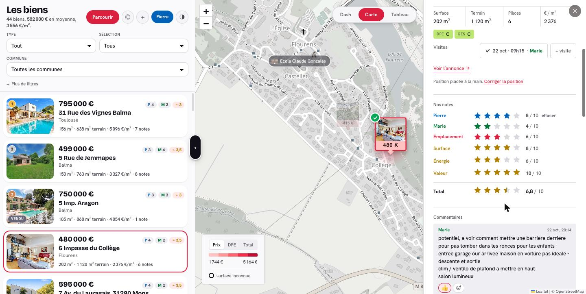
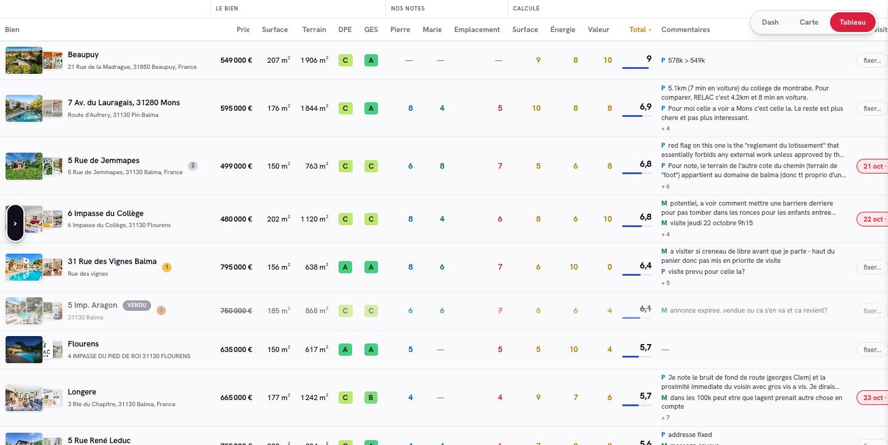
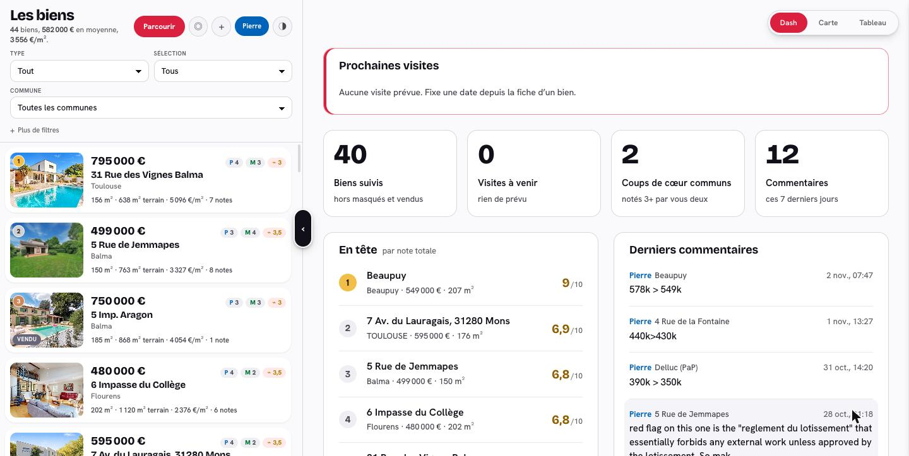
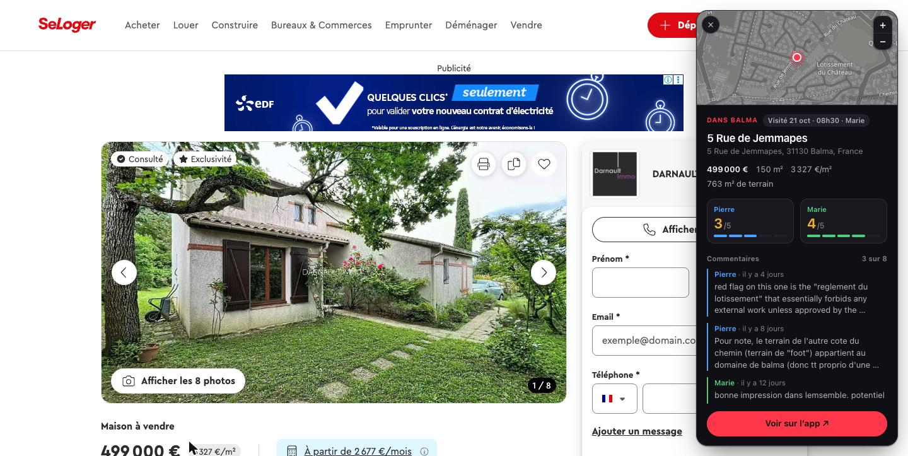
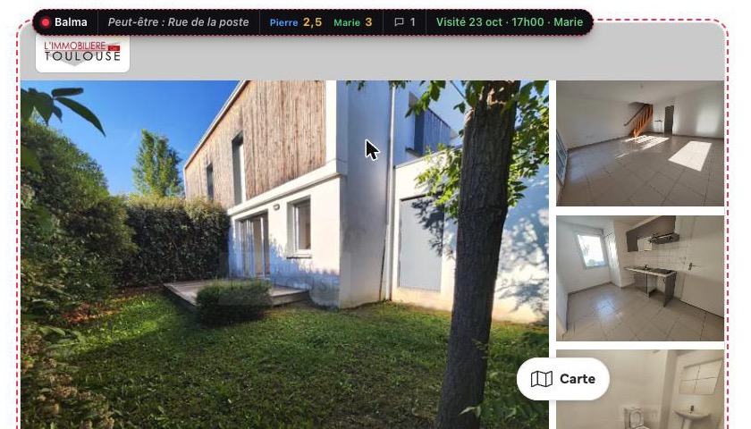
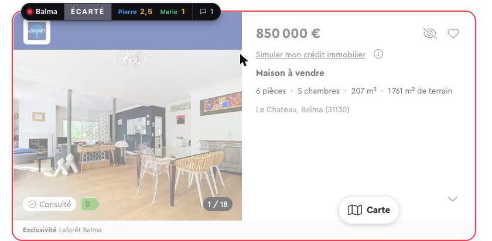

# Property Map

A shared notebook for property hunting. Every place you are
considering goes on one map. Each of you scores it, you both comment, you add
your own photos and documents, and you plan the visits. The listing sites only
let you look at adverts. This is for deciding between them.

It was built for one couple's search in France, so the interface is in French
and it reads adverts from the French portals: SeLoger, Leboncoin, Belles
Demeures and Laforêt. The map, scoring and sharing work anywhere. Only the
import from listing pages is specific to those sites.



<table>
  <tr>
    <td></td>
    <td></td>
  </tr>
  <tr>
    <td></td>
    <td></td>
  </tr>
</table>

*Screenshots from the original deployment. Its two editors were Pierre and
Marie, where this code says Alex and Sam.*

## What it does

- **Map and table** of every property, with pins coloured by price per m² or
  by energy rating (DPE). Every column in the table can be sorted.
- **Two editors and a guest.** `alex` and `sam` keep the record. They score,
  edit and delete. `guest` is read-only: it can comment and add photos and
  documents, but it cannot score, edit or delete. The API enforces this, so
  hiding the buttons is not the only safeguard.
- **Marks out of 5** per person, plus a shared mark for the location
  (*Emplacement*). Three more are derived from the data: size, energy and
  value for money. Together they give one total out of 10. A mark with nothing
  to go on drops out of the average instead of counting as zero.
- **Shortlists**: your 4+, the other person's 4+, and the ones you both like.
- **Visits**: who went and when. A dashboard lists upcoming visits and the
  ones you haven't scored yet.
- **Photos, videos and documents** per property. Uploads go straight from the
  browser to S3 with presigned URLs, so files outlive the advert.
- **Add a property** by dropping a pin on the map, with the bookmarklet, or
  with the Chrome extension. On a listing page, the bookmarklet reads the
  price, surface, rooms, land, DPE/GES and photos from the page and opens the
  form already filled in.
- **Chrome extension** (`extension/`): on an advert you already have, it shows
  your marks, comments and visit in a card in the corner. On a results page it
  flags every advert you already have, including ones re-listed by another
  agency.

  

  <table>
    <tr>
      <td></td>
      <td></td>
    </tr>
  </table>

- **Email** to the other person when you comment, add a property or upload
  files (optional, via Amazon SES).
- **Works on a bad connection.** The app shell, the data and the map tiles
  are cached. Edits queue up and send themselves when the connection returns.

No build step and no framework. The front end is plain HTML and JS with
Leaflet and OpenStreetMap tiles, and the API is a single Lambda file. See
[docs/ARCHITECTURE.md](docs/ARCHITECTURE.md) for the data model, routes and
reasoning.

## Try it locally

```sh
cd web && python3 -m http.server 8000
```

Open http://localhost:8000. With no API behind it, the app runs on the sample
data in `web/properties.js` and keeps your changes in the browser. Pick any
login and type any code: the real check lives in the API.

## Deploy your own (AWS)

It runs on DynamoDB, one Lambda, two S3 buckets and CloudFront. At household
scale it costs well under a dollar a month, mostly for photo storage. You need
the AWS CLI logged in to your account, plus Node 22, Python 3 and `openssl`.

```sh
cp infra/config.example.sh infra/config.sh   # then edit: profile, names, optional domain/email
npm install                                   # AWS SDK for the local scripts
bash infra/provision.sh                       # creates everything; safe to re-run
bash infra/redeploy.sh                        # uploads the site and the API
node api/seed.mjs                             # loads web/properties.js, creates the logins
```

`seed.mjs` prints a random password for each login, once. Note them down. No
password ships with the code. To change one later, or to add an email for
notifications:

```sh
node api/add-user.mjs sam "Sam" "new-password" --email=sam@example.com --force
```

After five wrong passwords a login is locked for 15 minutes. Each further lock
doubles in length, up to a day.

**Your own domain:** set `DOMAIN` in the config before provisioning. The
script requests a certificate and prints the DNS record that validates it.
Once it shows as issued, run `bash infra/attach-alias.sh` and add the CNAME it
prints.

**Email:** verify a domain or address in SES, then set `SES_IDENTITY` and
`MAIL_FROM` and re-run `provision.sh`. Leave them empty to turn email off.

**The extension:** replace `your-app.example.com` with your app's address in
`extension/manifest.json`, `background.js` and `content.js`. Then go to
`chrome://extensions`, enable developer mode, choose *Load unpacked*, and pick
the `extension` folder.

**Renaming people:** the ids `alex`, `sam` and `guest` appear in
`api/index.mjs` (`VALID_USERS`), `web/app.js` and `extension/content.js`
(`USERS`), the login buttons in `web/index.html`, and `api/seed.mjs`. The
display names are in the same places.

After changing `web/index.html` or `web/app.js`, bump `V` in `web/sw.js`. The
service worker serves the shell cache-first and only refetches it when
`sw.js` itself changes.

## A note on the listing sites

The bookmarklet and the extension read listing pages inside your own browser,
with your own session, one advert at a time while you look at it. Server-side
scraping is blocked by those sites, and nothing here attempts it. Their image
CDNs are open, and the API copies listing photos into your own bucket so they
survive the advert being taken down. Check that this fits the terms of the
sites you use it with.

## Licence

MIT. See [LICENSE](LICENSE).
